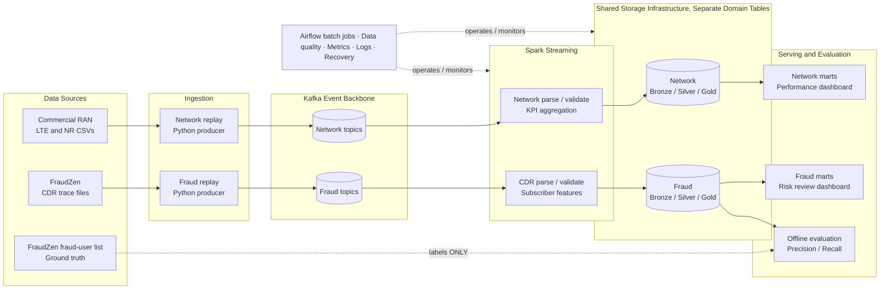

# Telecom Intelligence & Fraud Data Platform

> **Project handbook and architecture blueprint**  
> **Version:** 1.0 — initial design  
> **Date:** October 22, 2026  
> **Status:** Architecture proposed; datasets inspected at an initial level; pipelines **not yet implemented**  
> **Scope:** 4G/5G Network Performance Monitoring + SIMBox Fraud Detection  
> **Audience:** Data engineers, reviewers, and anyone studying the system end to end

---

## How to use this document

This document is the **single starting point** for understanding the project. Read it in this order:

1. **Sections 1–4:** Why the platform exists, what it does, and what data we actually have.
2. **Sections 5–10:** Architecture, data movement, streaming, processing, and storage.
3. **Sections 11–15:** The two data products, serving interfaces, orchestration, and reliability.
4. **Sections 16–22:** Deployment, testing, implementation plan, risks, and glossary.

The most important distinction throughout this document is:

- **CONFIRMED:** Observed in the user's local sample/terminal output or explicitly documented by the dataset authors.
- **PROPOSED:** Our initial engineering design. It may change after proof-of-concept testing.
- **NOT YET VERIFIED:** Something that must be established before relying on it in production-like calculations.

A complete-looking architecture diagram does **not** mean the software has been built, the data validated, or the models trained.

## Contents

1. [Executive overview](#1-executive-overview)
2. [The business problems](#2-the-business-problems)
3. [Scope and boundaries](#3-scope-and-boundaries)
4. [Our datasets: what is confirmed](#4-our-datasets-what-is-confirmed)
5. [System architecture](#5-system-architecture)
6. [Core concepts and component responsibilities](#6-core-concepts-and-component-responsibilities)
7. [Events, schemas, identities, and time](#7-events-schemas-identities-and-time)
8. [Data ingestion and historical event replay](#8-data-ingestion-and-historical-event-replay)
9. [Kafka design](#9-kafka-design)
10. [Spark processing and lakehouse design](#10-spark-processing-and-lakehouse-design)
11. [Network Monitoring data product](#11-network-monitoring-data-product)
12. [SIMBox Fraud Detection data product](#12-simbox-fraud-detection-data-product)
13. [Serving, dashboards, and alerts](#13-serving-dashboards-and-alerts)
14. [Batch processing and Airflow](#14-batch-processing-and-airflow)
15. [Reliability, data quality, and observability](#15-reliability-data-quality-and-observability)
16. [Security, privacy, and governance](#16-security-privacy-and-governance)
17. [Local environment and future cloud deployment](#17-local-environment-and-future-cloud-deployment)
18. [End-to-end walkthroughs](#18-end-to-end-walkthroughs)
19. [Implementation phases](#19-implementation-phases)
20. [Acceptance criteria and testing strategy](#20-acceptance-criteria-and-testing-strategy)
21. [Open questions and engineering decisions](#21-open-questions-and-engineering-decisions)
22. [Glossary and source references](#22-glossary-and-source-references)

---

# 1. Executive overview

## 1.1 The idea

We are building **one shared telecom data platform** that hosts **two independent data products**:

1. **Network Monitoring:** Analyze 4G/5G Radio Access Network (RAN) performance counters, understand utilization and service degradation, and generate explainable alerts.
2. **SIMBox Fraud Detection:** Analyze mobile-network Call Detail Records (CDRs), build subscriber behavior profiles, identify suspicious SIMBox-like activity, and evaluate those predictions against known synthetic fraud labels.

The two products share engineering infrastructure, not a fabricated business identity. Their datasets originate from **different environments** and have **no proven common subscriber, tower, or operator identifiers**.

### One platform does not mean one giant data pipeline

The platform provides shared capabilities such as Kafka, Spark, storage, observability, deployment, and quality checks. Each domain has its **own event schemas, processing jobs, Silver/Gold tables, analytics, and business rules**.

```text
                         TELECOM DATA PLATFORM

   Network performance domain             Fraud / CDR domain
   --------------------------             ------------------
   Commercial LTE + 5G CSVs               FraudZen scenario files
              |                                     |
     Network Replay Producer                CDR Replay Producer
              |                                     |
      Kafka network topics                   Kafka fraud topics
              |                                     |
       Spark network jobs                     Spark fraud jobs
              |                                     |
        Network data marts                      Fraud data marts
              |                                     |
     Performance & alerts                   Risk & evaluation
              \_____________________________________/
                              |
                  Shared infrastructure
             Storage · Data quality · Monitoring
               CI/CD · Docker · Batch tooling
```

**Important:** Streaming will be technically real (Kafka and continuously executing stream processors), while the input will be **replayed historical/synthetic records**, not a live feed from a real telecom operator.

## 1.2 Why this is a strong data engineering project

The main objective is not to demonstrate that a CSV can be loaded into Spark. The objective is to demonstrate:

- Correct separation of business domains and data contracts.
- Bounded-memory ingestion and controlled event replay.
- Kafka concepts: topics, keys, partitions, offsets, consumer lag, retention.
- Structured Streaming: event time, checkpoints, recovery, deduplication, and stateful aggregations.
- Batch + streaming data consistency and reproducible backfills.
- Medallion modeling with traceability from Gold results to source records.
- Meaningful engineering metrics, alerts, tests, and failure handling.
- Honest handling of imperfect real/synthetic datasets and detection limitations.

## 1.3 What success looks like

A reviewer can run the local system, select a scenario, observe events entering Kafka, inspect their Bronze/Silver/Gold representations, see a network KPI change or a fraud-risk result, and verify that stopping/restarting services does not silently duplicate or lose the final output.

---

# 2. The business problems

## 2.1 Business problem A — Network performance

A telecom operator needs visibility into the condition and utilization of radio infrastructure.

Questions we want the system to answer:

- Which sites/sectors show unusually high resource utilization?
- Which sites show declining or unstable radio quality metrics?
- How does user load change over time?
- Which sectors consume more energy under similar observed utilization?
- Are expected performance counter intervals missing or delayed?
- Can the operations team find an understandable explanation for an alert?

**Consumer:** Network Operations Center (NOC), network analysts, or optimization engineers.

**Output:** Sector/time KPI tables, trends, data freshness checks, and **performance degradation indicators**.

**Important limitation:** The available PM dataset does **not** provide verified failure/incident labels. We cannot honestly claim confirmed root-cause diagnosis or verified outage detection without additional ground truth.

## 2.2 Business problem B — SIMBox bypass fraud

SIMBox fraud can route incoming international traffic through local SIM cards to exploit differences in how calls are charged and terminated. Fraudsters may imitate ordinary subscribers to evade detection.

Questions we want the system to answer:

- Which subscribers show an unusually concentrated or repetitive call pattern?
- Which devices/SIM identifiers are associated with abnormal traffic distributions?
- Do usage patterns change in suspicious ways across time windows?
- How should subscriber risk scores be computed and explained?
- How well do our predictions identify **known simulated fraudulent subscribers**?
- What false positives might affect legitimate subscribers?

**Consumer:** Fraud operations analyst or revenue assurance team.

**Output:** Subscriber-window features, candidate alerts, investigation records, and offline Precision/Recall evaluation.

**Important limitation:** The dataset is synthetic and models **SIMBox/international bypass fraud**. It does not establish detection quality for SIM-swap, account takeover, payment fraud, or actual customer networks.

## 2.3 Key difference between the two domains

| Area | Network Monitoring | Fraud Detection |
|---|---|---|
| Primary entity | Technology + site + sector + time | Subscriber/device + time + scenario |
| Main input | Periodic 4G/5G aggregate counters | Per-event CDR traces |
| Typical cadence | 15-minute source aggregates | Irregular event timestamps |
| Primary analysis | Radio KPIs, baselines, degradation | Behavioral features, suspicious patterns |
| Labels | No confirmed outage labels | Known fraudulent-user IDs in selected run |
| Main risk | Misinterpreting counters/zero values | Leakage, wrong labels, false positives |
| First implementation | Interpretable statistical rules | Interpretable behavioral rules |

---

# 3. Scope and boundaries

## 3.1 Included in the initial project

- Two separate source families: commercial RAN PM data and FraudZen CDR data.
- Historical-data replay with controllable rate and reproducible run metadata.
- Kafka transport for each domain.
- Independent Spark Structured Streaming jobs.
- Raw, cleaned, and curated storage layers.
- Structured quarantine for invalid/unparseable records.
- Basic KPI and risk-score serving tables.
- Initial dashboards and actionable, reviewable alerts.
- Batch reprocessing, data quality, lineage, and operational monitoring.
- Offline evaluation for FraudZen labels.

## 3.2 Not included in the initial project

- Network intrusion detection / cybersecurity use cases.
- Direct ingestion from real mobile network hardware or operator systems.
- A real-time SMS/voice billing or charging platform.
- Automatic blocking or suspension of a subscriber.
- A claim of confirmed outage-root-cause detection from the PM counters.
- A unified Customer 360 linking commercial RAN records to synthetic FraudZen subscribers.
- A trained ML model or AI agent in the first milestone.
- Multi-cloud deployment or Kubernetes solely for appearance.

## 3.3 Explicit dataset boundary

```text
Commercial RAN PM identifiers:     Site / Sector / Technology
FraudZen synthetic identifiers:    Phone number / IMEI / Synthetic cell ID

There is NO established mapping from one namespace to the other.
Therefore: no cross-domain record-level join.
```

Sharing infrastructure and dashboards is acceptable. Claiming that a FraudZen fraudster generated a problem at a particular real commercial RAN site is not.

---

# 4. Our datasets: what is confirmed

## 4.1 Network dataset — commercial RAN performance counters

**Official title:** *Performance Management Counters from Live 5G, 4G and 2G Radio Access Network*  
**Source:** https://zenodo.org/records/17815388  
**License:** CC BY 4.0 (per supplied README)  
**Source type:** Real, anonymized commercial network performance measurements.  
**Documented granularity:** 15-minute aggregated measurements; README says timestamps are UTC.

The source contains three ZIP archives. Our **currently inspected** files are inside `Dataset_01`, under one baseband:

| Local file | Radio configuration | Rows observed | Columns observed |
|---|---|---:|---:|
| `Dataset_01_LTE_2100.csv` | LTE / 4G / 2100 MHz | 151,026 | 19 |
| `Dataset_01_NR_1800.csv` | NR / 5G / 1800 MHz | 151,026 | 19 |
| **Total** | Two source files | **302,052** | 19 per file |

These counts come from the user's local command, **not** a complete dataset audit.

### Mandatory identity columns

- `Base station` — anonymized site identifier.
- `Sector` — sector number.
- `Timestamp` — documented UTC measurement timestamp.

### 4G counter columns (observed headers)

```text
Radio unit energy consumption
Baseband energy consumption
4G max active users DL
4G max active users UL
4G data volume DL
4G data volume UL
4G max RRC users
4G RB utilization
4G CQI rank 1
4G CQI rank 2
4G CQI rank 3
4G CQI rank 4
4G RRC users
4G active users UL
4G active users DL
4G MIMO rank DL
```

The 5G file has the analogous `5G`-prefixed counter columns.

### Meaning of selected network terms

| Term | Practical meaning | Important caveat |
|---|---|---|
| DL / UL | Downlink / uplink direction | Direction is part of the measure's meaning |
| RRC users | Radio Resource Control connected users/related counter | `max` and other variants are not interchangeable |
| RB utilization | Utilization of radio resource blocks | Must be interpreted with radio bandwidth/configuration |
| CQI | User equipment–reported channel quality indicator | Active CQI table configuration is not supplied |
| MIMO rank | Spatial multiplexing indicator | Do not reduce it to an outage flag |
| Radio/baseband energy | Reported energy-counter values | Not necessarily direct per-cell energy usage |

### Known cautions from the dataset authors

1. Missing and zero values are intentionally retained from operational PM exports.
2. Energy is reported at radio-unit/baseband level, not directly as per-cell energy.
3. RB utilization requires channel-bandwidth context.
4. CQI interpretation depends on details not fully included in the dataset.

### Still unverified

- Full time coverage and number of distinct sites/sectors.
- Data types, null/zero proportions, and outliers across the files.
- Whether `(technology, site, sector, timestamp)` is unique.
- Whether LTE and NR station/sector identifiers actually map to the same physical asset.
- Whether counters are consistently collected on every expected interval.
- Whether any ground-truth service incidents or maintenance events are available.

## 4.2 Fraud dataset — FraudZen

**Official title:** *FraudZen Dataset: Realistic Ground Truth CDRs of Bypass Fraud Techniques in Mobile Networks*  
**Source:** https://zenodo.org/records/15706356  
**Simulator:** https://gitlab.inria.fr/simbox-fraud-mitigation/fraudzen  
**License:** CC BY 4.0 (as described in supplied README)  
**Source type:** **Synthetic** mobile CDR traces generated by a research simulator.

The simulator provides variations of fraud strategy, fraud prevalence, and number of fraudulent SIMs. Example strategy groups observed:

```text
FraudZen_Cdrs/
  advanced_mobility/
  advanced_social/
  advanced_traffic/
  all_advanced/
  all_naive/
  ...

<selected_scenario>/
  fraudulentUsers.txt
  International_CDRTrace.txt
  Op_1_CDRTrace.txt
  softswitch_canceled_calls.txt
```

Other input/configuration folders enable regeneration or further simulated experiments.

### What each relevant file means

| File | Purpose | Proposed treatment |
|---|---|---|
| `Op_1_CDRTrace.txt` | Local/national events: calls, data, SMS, including fraudulent users | Main activity feature source after event-type filtering |
| `International_CDRTrace.txt` | Incoming international call traces (examples use `I-MTC`) | Separate international call event stream |
| `fraudulentUsers.txt` | Subscriber numbers designated fraudulent in that simulation | **Offline evaluation only** |
| `softswitch_canceled_calls.txt` | Rejected/canceled international termination requests within the simulation | Optional analytical extension after field audit |

### Expected field names, from user-observed headers

```text
timestamp  CDR_type  src_number  src_imei
initial_src_cellId  current_src_cellId
dst_number  dst_imei
initial_dst_cellId  current_dst_cellId
duration  size
```

### What we directly observed in CDR samples

- Timestamps such as `17-3-2021 0:0:0` and `17-3-2021 0:0:38`.
- Local events with type `DATA` (not voice calls).
- International events with type `I-MTC`.
- Synthetic numbers, IMEIs, and synthetic cell IDs.
- International sample rows where the final `size` value appeared to be missing despite being in the header.
- Timestamp timezone **not established** by the sample or supplied README.

**Parsing warning:** The supplied files are visually whitespace-delimited, but the date and time are two separate whitespace tokens. Blind positional assignment after `split()` would shift all columns. The parser must combine date+time as the timestamp and then validate the remaining fields.

### Ground-truth matching test — selected scenario

User's local test returned:

```text
Fraudulent users: 100
Op_1_CDRTrace.txt
Matched users: 100
Matched records: 690
International_CDRTrace.txt
Matched users: 0
Matched records: 0
```

Interpretation:

- The selected run's fraud ID list contains 100 users.
- All 100 were found in the selected local CDR file.
- 690 local records involved at least one labeled fraudulent user.
- No **direct source/destination number** matches were found in the sampled international file by that test.
- **690 records are not automatically 690 fraudulent voice calls.** They could include various event types and legitimate activity by fraudulent subscribers.
- The test does **not** prove that each international event can be correlated to a specific local one.

### Still unverified

- Number of all events, distribution by `CDR_type`, per-scenario sizes, and time span.
- Semantics of international-to-local trace linkage and whether reliable call correlation is possible.
- Missing `size` behavior throughout the international file.
- Timezone interpretation for FraudZen timestamps.
- Which field should define the *subscriber being scored* in each kind of event.
- Whether the 100 labeled users and trace events are scoped to one run exactly, or whether a folder embeds multiple runs that must be separated.
- Data quality, class prevalence, and feature distributions for the full selected scenario.

## 4.3 Why we are not combining the raw sources

The network data are from a commercial RAN dataset. FraudZen was created by a simulator. Matching integers or similar dates do **not** create real-world relationships. Their timestamps also refer to different source histories. We maintain two domains with explicit namespaces.

---

# 5. System architecture

## 5.1 High-level architecture diagram

> This Mermaid diagram is readable in Markdown viewers that support Mermaid, including VS Code with an appropriate preview extension. It is a **logical design**, not a deployment confirmation.



## 5.2 Layered view

| Layer | Main job | Example responsibility |
|---|---|---|
| Source | Original datasets | Preserve original file and dataset version |
| Ingestion | Read and emit events | Rate control, timestamp mapping, event ID |
| Transport | Carry events reliably | Kafka topics, offsets, partitioning |
| Processing | Transform and aggregate | Spark streaming, quality checks, windows |
| Lakehouse | Durable analytical history | Bronze/Silver/Gold tables |
| Serving | Fast consumption | KPI/risk marts, dashboards, alerts |
| Control plane | Schedule and operate | Batch orchestration, replays, configuration |
| Observability | Diagnose problems | Throughput, lag, freshness, errors |

## 5.3 Engineering principle: isolate failures by domain

A broken fraud input file should **not** stop network performance processing. Each domain will use separate topics, Spark checkpoints, error tables, and data-product schemas. Common infrastructure can still be a shared failure point; Docker/monitoring should make that visible.

## 5.4 Two different paths for data and labels

```text
CDR events --------------------> Fraud processing --> Features --> Risk scores

fraudulentUsers.txt ------------------------------------------------------>
                       Isolated OFFLINE evaluation of scored subscribers
```

The label list never enters inference features, streaming filters, or online decision rules.

---

# 6. Core concepts and component responsibilities

## 6.1 Python Replay Producers

**What they do:** Incrementally read source records, parse enough metadata for routing, stamp deterministic IDs, and publish events to Kafka at a controlled rate.

**What they do not do:** Train models, assign fraud status from ground truth, or silently invent new timestamps as though they were original.

Each producer should support:

- A selected file/scenario and unique run identifier.
- Start, stop, replay speed, and optional bounded event count.
- File-backed streaming (avoid loading whole datasets into RAM).
- Schema version, producer logs, and recovery progress.
- Event ordering policy documented per source.
- Controlled injection of duplicate, delayed, and invalid messages for testing.

## 6.2 Apache Kafka

**What it does:** Decouples producers from processors; buffers events; maintains per-partition order and offsets.

**What it does not do:** Automatically remove domain duplicates or serve as the final analytical warehouse.

## 6.3 Spark Structured Streaming

**What it does:** Reads Kafka records, validates them, converts data types, writes tables, and calculates time-aware aggregates and scores.

**What it does not guarantee by itself:** Exactly-once external API calls or automatic correctness of business event time.

## 6.4 MinIO and Delta Lake — proposed

- **MinIO:** Local S3-compatible object storage.
- **Delta Lake:** Table format/transaction log proposed for batch + streaming datasets and schema evolution.

**Caution:** We must test Spark, Delta, Hadoop/S3 libraries, and MinIO together before fixing versions. Object store commit behavior and concurrent writers require deliberate testing.

## 6.5 PostgreSQL — proposed serving database

Keeps relatively small, queryable KPI/risk marts and alert status records for dashboards. It is not intended to hold every raw historical row forever.

## 6.6 Airflow — proposed batch orchestrator

Manages scheduled or on-demand initial loads, consistency checks, recalculations, and backfills. Long-running streaming Spark jobs should be operated as separate services, not as never-ending Airflow tasks.

## 6.7 Dashboard — one tool initially

Choose **Streamlit** for a developer-friendly project UI or **Grafana** for an operations-centric presentation after testing actual needs. Both are optional choices; do not install everything on day one.

---

# 7. Events, schemas, identities, and time

## 7.1 Proposed common event envelope

Every Kafka event includes stable, traceable metadata.

```json
{
  "event_id": "sha256:<deterministic-digest>",
  "domain": "network",
  "event_type": "ran_pm_measurement",
  "schema_version": 1,
  "source_dataset": "commercial_ran_pm_v1",
  "source_file": "Dataset_01_LTE_2100.csv",
  "source_row_number": 1234,
  "source_scenario": null,
  "replay_run_id": "demo_run_001",
  "original_timestamp_raw": "2023-10-08 06:00:00",
  "original_event_time": "2023-10-08T06:00:00Z",
  "replay_event_time": null,
  "ingestion_time": "<populated-at-publish-time>",
  "payload": {"technology": "LTE", "site_id": "Site 36", "sector_id": 2}
}
```

**Illustrative schema only.** The example is not proof that a particular source row is number 1234 or that `demo_run_001` has been run.

### Critical identity rules

- `event_id` should be **stable across retries and repeated runs of the same source event**: hash dataset version, source file, scenario/run source identity, original row position, and/or immutable raw content.
- `replay_run_id` changes per experiment, but should generally **not** change the intrinsic ID of a source event.
- Track a separate ingestion attempt/run when we intentionally want to compare repeated test runs without conflating measurements.
- If the source can produce genuinely identical events, do not deduplicate based only on matching payload values.

## 7.2 Three important timestamps

| Field | What it means | Why it matters |
|---|---|---|
| `original_event_time` | When source claims the event or measurement occurred | Historical truth and reproducibility |
| `replay_event_time` | Optional mapped time on a scaled replay clock | Controlled demonstrations/time windows |
| `ingestion_time` | When our producer actually delivered the event | Pipeline delay and service observability |

**Network:** Source documentation says timestamps are UTC.  
**FraudZen:** Timezone is not yet confirmed; keep raw text and define a documented conversion policy after inspection.

A **CDR timestamp** should not automatically be treated as the exact instant a call began, ended, or became available to the operator without checking the source semantics.

## 7.3 Expected schemas after normalization

### Network Silver measurement

```text
source_event_id          string
technology               enum(LTE, NR)
site_id                  string
sector_id                string/integer after profiling
measurement_time_utc     timestamp
radio_unit_energy        numeric, nullable
baseband_energy          numeric, nullable
active_users_dl          numeric, nullable
active_users_ul          numeric, nullable
max_active_users_dl      numeric, nullable
max_active_users_ul      numeric, nullable
data_volume_dl           numeric, nullable
data_volume_ul           numeric, nullable
rb_utilization           numeric, nullable
rrc_users                numeric, nullable
cqi_rank_1..4           numeric, nullable
mimo_rank_dl             numeric, nullable
source_file              string
schema_version           integer
quality_flags            array<string>
```

Unit names and numerical ranges are not asserted until checked against the official descriptor and actual data.

### Fraud Silver event

```text
source_event_id          string
scenario_id              string
source_trace_type        enum(local, international, canceled_call)
event_time_raw           string
event_time_parsed        timestamp (timezone policy applied)
cdr_type                 string
src_number               string
dst_number               string
src_imei                 nullable string
dst_imei                 nullable string
initial_src_cell_id      nullable string
current_src_cell_id      nullable string
initial_dst_cell_id      nullable string
current_dst_cell_id      nullable string
duration_seconds         nullable numeric
size                     nullable numeric
source_file              string
quality_flags            array<string>
```

`unknown`, zero IDs, and missing trailing fields need explicit parsing/quality semantics. Do not automatically convert every zero into `NULL`.

## 7.4 Schema compatibility policy — proposed

- Source schema versions are explicit.
- Additive fields can be introduced with nullable defaults after testing.
- Breaking changes require a versioned contract or new Kafka topic version.
- Unknown fields or malformed records are quarantined with an error reason.
- No silent numeric coercion (for example interpreting a missing duration as `0`).

---

# 8. Data ingestion and historical event replay

## 8.1 Why replay?

The source datasets are files. Real companies collect events using network exporters, charging systems, telemetry gateways, connectors, or other operational systems. We cannot access those operational endpoints, so replay tests the **stream processing system** realistically without claiming to have a live operator feed.

```text
CSV / CDR trace -> bounded file reader -> parser -> replay scheduler
                                            |
                                 Kafka producer with key
                                            |
                                     Kafka topic
```

## 8.2 Time-scaled replay

For a source event occurring `delta_source` seconds after the replay baseline:

```text
scheduled_wall_time = replay_start_wall_time + delta_source / speed_factor
```

Example: a 15-minute source gap becomes 90 seconds at 10× speed.

**Network nuance:** Many sites/sectors can share the same source timestamp; schedule them as a group or with deterministic interleaving. Sorting by timestamp can be an offline replay preparation step, but the producer should still avoid unnecessary full-file memory loading.

**Fraud nuance:** CDR events may occur irregularly and may be across scenario runs; isolate scenarios and preserve within-run timeline before replaying.

## 8.3 Modes we may implement

| Mode | Purpose | Interpretation |
|---|---|---|
| Original-time replay | Preserve source time gaps | Most faithful temporal experiment |
| Accelerated replay | Demonstrate quickly | Same relative gaps, scaled clock |
| Fixed-rate replay | Stress-test throughput | Engineering load test, not real timing |
| Burst replay | Test backpressure/recovery | Deliberately synthetic delivery pattern |

A fixed-rate stream is **not** evidence of the original event arrival distribution.

## 8.4 Producer failure handling

- Emit to Kafka with producer delivery acknowledgments and suitable retry settings.
- Keep logs of publish errors and source progress.
- When a replay restarts, deterministic IDs make duplicate production visible/removable downstream.
- A producer checkpoint does not replace downstream idempotency.
- Make injection of missing, late, and malformed events a separate test mode.

---

# 9. Kafka design

## 9.1 Proposed topics

| Topic | Producer | Message key — initial proposal | Consumer |
|---|---|---|---|
| `network.lte.pm.v1` | LTE replay producer | `site_id:sector_id` | Network Spark job |
| `network.nr.pm.v1` | NR replay producer | `site_id:sector_id` | Network Spark job |
| `fraud.local-cdr.v1` | Local trace producer | Event subject key once semantics are verified | Fraud Spark job |
| `fraud.international-cdr.v1` | International trace producer | Source/event routing key; still to be defined | Fraud Spark job |
| `platform.invalid-events.v1` | Optional quarantine publisher | Source event ID | Review/observability consumer |

We should not select a subscriber partition key until we know which party is actually under investigation in every CDR event type. Forcing all CDRs to `src_number` can misaggregate activity.

## 9.2 Kafka vocabulary

- **Topic:** Named event stream.
- **Partition:** Ordered subset of a topic; provides parallelism.
- **Key:** Determines partition assignment when using key-based partitioning.
- **Offset:** Position of an event inside a partition.
- **Consumer group:** Allows consumers to divide partitions.
- **Retention:** How long Kafka holds events; not the permanent history of the platform.
- **Consumer lag:** Difference between written and consumed events; important for backpressure.

**Ordering guarantee:** Kafka preserves order **within a partition**, not across the entire topic or independent topics.

## 9.3 Configuration to decide after a small performance test

- Initial partition counts and number of Spark executors.
- Replication factor suitable for single-node local development (production differs).
- Broker retention period and disk budget.
- Producer delivery semantics and retries.
- Event payload encoding (JSON first, then optionally Avro/Protobuf plus schema tooling).

We should not invent production-scale partition counts without target throughput measurements.

---

# 10. Spark processing and lakehouse design

## 10.1 The Medallion pattern

```text
Kafka -> BRONZE -> SILVER -> GOLD -> Serving
         raw       clean     business
```

### Bronze — raw event preservation

Store the source event envelope, original payload, source lineage, raw timestamps, ingestion timestamps, and any validation outcomes. Keep enough fidelity to reprocess with improved parsing logic.

**Example table names**

- `bronze.network_lte_events`
- `bronze.network_nr_events`
- `bronze.fraud_local_cdr_events`
- `bronze.fraud_international_cdr_events`

### Silver — typed, validated, reusable data

Normalize units and column names; preserve null-vs-zero semantics; create stable typed fields and quality flags; quarantine invalid records separately.

**Example tables**

- `silver.ran_pm_measurements`
- `silver.fraud_cdr_events`
- `silver.rejected_events`

### Gold — curated business outputs

Create tables aligned with the data products, not a single universal Gold table.

**Example tables**

- `gold.network_sector_kpis_15m`
- `gold.network_degradation_indicators`
- `gold.fraud_subscriber_features_hourly`
- `gold.fraud_subscriber_risk_scores`
- `gold.fraud_offline_evaluation` (**isolated offline path**)

## 10.2 Stream processing responsibilities

1. Read Kafka offsets for the correct topic.
2. Parse envelope and validate schema version.
3. Write durable Bronze records.
4. Normalize source-specific fields into Silver.
5. Use deterministic keys and safe deduplication.
6. Compute domain-specific aggregates or features.
7. Write Gold output with replay/recovery-safe sink semantics.
8. Publish/reconcile serving marts and alert candidates.

This is a **logical sequence**, not a promise that all eight happen inside one Spark query. Separate queries/jobs may be preferable for isolation and independent backfills.

## 10.3 State, windows, and watermarks

**Window aggregation:** For example, calculate a count per site/sector/15-minute interval or a count of events per subscriber/hour.

**Event time:** Uses timestamp attached to the source event, not only processing arrival time.

**Watermark:** A declared tolerance for late data that lets a stateful stream eventually release old state. Choosing it requires measurement of delay, replay behavior, and required correction policy.

**Late data:** Events after the chosen cutoff require an explicit rule: flag, update a historical table, or send to a corrective backfill. Do not silently pretend every late event was incorporated.

## 10.4 Checkpointing and exactly-once nuance

Spark checkpoints progress and state so a supported streaming sink can resume after failure. This **does not imply exactly-once emails, HTTP callbacks, or every external table write**.

For external sinks:

- Use idempotent upserts keyed by domain/business identity.
- If using `foreachBatch`, track `batch_id` and provide transactional/duplicate-safe writes.
- Consider a transactional outbox for outgoing alert notifications.
- Test restart while processing the same microbatch.

## 10.5 Upsert identity matters

For **network Gold**, a tentative key is `(technology, site_id, sector_id, window_start, metric_definition_version)`. Confirm whether the input has duplicates, how counter corrections work, and whether a baseband/radio-unit dimension is needed.

For **fraud Gold**, a tentative key is `(source_dataset_version, scenario_id, subscriber_id, window_start, rule_version)`. Confirm subscriber identity and how repeated simulation runs are distinguished.

---

# 11. Network Monitoring data product

## 11.1 Data journey

```text
LTE/NR CSV -> Replay -> Kafka -> Silver PM measurements
                                 |
                          Sector KPI aggregates
                                 |
                    Baseline comparison / flags
                                 |
                     Network KPI mart / dashboard
```

## 11.2 First product features

**Phase 1 KPIs:**

- Active user counts by technology, sector, and interval.
- DL and UL data-volume trends.
- RB utilization trends.
- CQI-related indicators where definition is understood.
- RRC user trends.
- Radio/baseband energy counter trends, with proper scope labels.
- Missing/late expected 15-minute measurement indicators.

## 11.3 Example network degradation logic (illustrative)

A first alert rule may flag unusually elevated utilization together with declining quality **relative to a historical baseline**, rather than using one arbitrary threshold for every cell.

```text
for each (technology, site, sector, interval):
    validate measures and data availability
    compare current measures to sector-specific historical baseline
    if sustained degradation is supported by multiple valid indicators:
        create explainable degradation candidate
```

Anomalous zero values should also be investigated as potential missing instrumentation, idle periods, or real operating conditions. **Zero != confirmed outage.**

## 11.4 Example Gold model

| Field | Meaning |
|---|---|
| `technology` | LTE / NR |
| `site_id`, `sector_id` | Operational dimension |
| `window_start_utc`, `window_end_utc` | Aggregation period |
| `active_users_dl` | Appropriate user metric for time window |
| `data_volume_dl`, `data_volume_ul` | Defined aggregation of the relevant counters |
| `rb_utilization` | Properly interpreted resource utilization |
| `quality_flags` | Missing/invalid counter flags |
| `degradation_score` | Initial explainable heuristic, not fault probability |
| `rule_version` | Reproducibility |

**Aggregation must respect counter type:** a maximum, average, gauge, cumulative counter, and interval volume should **not** all be blindly summed. Counter definitions must be checked before the final SQL/Spark expressions are approved.

## 11.5 How to evaluate without outage ground truth

- Compare aggregation outputs against manually calculated sample windows.
- Test missing-interval and malformed-counter detection with injected cases.
- Use synthetic fault injections as **tests**, clearly labeled synthetic.
- Report alert counts and investigator-readable examples.
- Do **not** publish outage prediction accuracy without true outage labels.

---

# 12. SIMBox Fraud Detection data product

## 12.1 Important fraud modeling principle

Ground-truth user labels are **not equivalent** to labels on every individual event. A listed fraud user may also generate ordinary events. The baseline detector should score **subscriber behavior over a time window** and evaluate at a matching subscriber/simulation scope.

## 12.2 Data journey

```text
Local CDR traces ------------> Parse and type check ----\
                                                       --> Subscriber activity model
International CDR traces ----> Parse and type check ----/    |
                                                            v
                                             Time-window behavioral features
                                                            |
                                             Explainable rules / risk score
                                                            |
                                             Review candidates / risk mart
                                                            |
                                   [SEPARATE OFFLINE EVALUATION ONLY]
                                                            ^
                                               fraudulentUsers.txt
```

**Caution:** The displayed arrow from both trace classes to the activity model represents using both *as separate observations*. It does not authorize a one-to-one cross-trace call join until real correlation keys/semantics are proven.

## 12.3 Parse by CDR type

- `DATA`: network data-use event, **not** a telephone call.
- `I-MTC`: incoming international terminating call, as identified by the supplied README.
- Other local call/SMS event types: inventory actual values before assigning meaning.

The parser needs a documented grammar and tests for `unknown`, missing trailing `size`, signed phone numbers, date/time reconstruction, and extra whitespace.

## 12.4 Candidate behavioral features — only after event semantics are verified

For a subscriber and time window:

- Number of relevant **voice calls**.
- Total voice-call duration and mean/median duration.
- Number of distinct called/calling counterparties.
- Number and diversity of observed device identifiers.
- Frequency of changing source/destination cell IDs when the actor identity is reliable.
- Calling time-of-day concentration and short-term bursts.
- Ratio of voice events to data/SMS events when meaningful.
- Frequency of unusually repeated patterns across nearby windows.

**We must not blindly calculate these from all rows:** `DATA` and international records with unknown device/cell data require different treatment.

## 12.5 Example initial scoring philosophy

A first baseline can be a transparent rule-based scoring model:

```text
subscriber_activity = aggregate(eligible_local_cdrs, window)

risk_factors = {
    "unusual_call_intensity": baseline_relative_rule(...),
    "distinct_counterparty_pattern": contextual_rule(...),
    "repetitive_short_calls": contextual_rule(...)
}

risk_score = versioned_weighted_score(risk_factors)
```

This is pseudocode. No numerical cutoffs or detection effectiveness have yet been established. The fraud-user label list is **never** accessed by this scoring process.

## 12.6 Offline evaluation

1. Select one clearly identified simulation scenario/run.
2. Produce scored subscribers **without using fraud labels**.
3. Read `fraudulentUsers.txt` only inside a separate evaluation job.
4. Compare predicted suspicious subscribers with labeled fraudulent subscribers.
5. Measure Precision, Recall, F1, and false-positive counts, with denominators explained.
6. Inspect mistakes and document representativeness limits.

**Avoid leakage:** Repeated Monte Carlo runs and reused synthetic user populations may leak patterns if rows are randomly divided into training/test sets. If ML is added later, prefer strict train/test splits by **simulation run/scenario and timeline** where appropriate, and document any repeated identities across splits.

## 12.7 What the zero international match tells us

It only tells us that the inspected international file did not directly contain the 100 fraud numbers in the checked `src_number` / `dst_number` fields. It **does not** prove the whole dataset is unusable, nor does it establish a usable international-to-local call ID.

Initial implementation should work with local CDR subscriber behavior and keep international CDRs as a separate analysis stream. Cross-stream correlation is a future research question.

## 12.8 Safety and operational interpretation

A fraud score is an **investigation signal**, not a basis for automatically blocking real accounts. Synthetic benchmark performance must never be advertised as verified real-world detection accuracy.

---

# 13. Serving, dashboards, and alerts

## 13.1 Proposed serving structure

```text
Gold tables -> publication/upsert job -> PostgreSQL marts
                                       |
                         +-------------+-------------+
                         |                           |
                 Network dashboard             Fraud dashboard
                         |                           |
                   Alert candidates           Review queue / scores
```

## 13.2 Network dashboard — minimum viable screens

- Site/sector selector and time-range filter.
- Trend plots for users, traffic volume, utilization, and quality indicators.
- Sector-level degradation candidates with explanation and affected timestamps.
- Freshness and missing-interval indicator.

## 13.3 Fraud dashboard — minimum viable screens

- Selected simulation and replay run.
- Ranked subscriber-risk candidates with reason codes.
- Subscriber time-window behavior drill-down.
- Separate **offline evaluation** page, clearly marked as using ground truth.
- Data-quality and parsing-error counts.

## 13.4 Alert lifecycle — proposed

`CANDIDATE -> OPEN -> ACKNOWLEDGED -> INVESTIGATING -> RESOLVED` (or `DISMISSED`).

Use stable alert keys, timestamps, rule versions, reason codes, and deduplication. Notifications need an idempotent dispatch mechanism to avoid duplicates after retries.

---

# 14. Batch processing and Airflow

## 14.1 Why batch is still necessary

A real data platform needs both **continuously processed events** and **historical correction/recalculation**. An improved parsing rule or a wrong KPI aggregation may require a full backfill.

## 14.2 Proposed Airflow DAGs

| DAG | Trigger | Responsibilities |
|---|---|---|
| `profile_source_datasets` | Manual / source addition | Count rows, inspect schema, null/zero stats |
| `backfill_network_kpis` | Manual / correction | Reprocess historical PM Bronze/Silver into Gold |
| `backfill_fraud_features` | Manual / correction | Recompute scenario-scoped behavioral windows |
| `reconcile_data_products` | Scheduled | Compare counts, freshness, completeness |
| `evaluate_fraud_offline` | Manual after scoring | Use fraud labels only for benchmark metrics |

Names are proposed. These DAGs do not exist yet.

## 14.3 Streaming vs Airflow

Airflow can submit/configure an operation, but persistent Spark streaming queries should have their own process lifecycle and monitoring. Do not create a single Airflow task that stays active forever waiting for Kafka events.

---

# 15. Reliability, data quality, and observability

## 15.1 Failure cases we must deliberately test

| Failure | Expected response |
|---|---|
| Producer restarts | Replay continues or safely replays; deterministic IDs let duplicates be controlled |
| Kafka temporarily unavailable | Producer retries with visible failure state; no silent success claim |
| Spark process crashes | Recovers from checkpoint with documented sink semantics |
| Same record re-emitted | Final outputs do not double count it |
| Malformed timestamp | Record quarantined with original text and reason |
| Missing FraudZen `size` | Nullable or quarantined according to explicit contract; never shift columns |
| Network counter is `0` | Retain and interpret by counter definition; do not call it an outage automatically |
| Event arrives out of order | Watermark/correction policy is applied consistently |
| Source schema changes | Validated, versioned, or rejected visibly |
| Backfill overlaps streaming write | Concurrency/idempotency controls prevent conflicting or duplicate Gold records |

## 15.2 Quality checks

**At ingestion:** Encoding, record count, source file metadata, parser success rate, required identities, timestamp parsing.  
**Silver:** Type ranges, null semantics, unique event IDs, valid technology/CDR type, logical duration and byte checks.  
**Gold:** Key uniqueness, expected completeness, reproducible aggregations, documented rule versions, absence of label leakage.

**A threshold is not a fact.** Baseline warning thresholds should be chosen after profiling actual distributions.

## 15.3 Observability metrics

- Kafka producer sends/s, errors, bytes/s, consumer lag per partition.
- Spark processing rate, input rate, microbatch duration, state size, checkpoint failures.
- Time from event to Bronze/Silver/Gold availability (using explicitly identified clock type).
- Invalid/quarantined event rate and schema-version distribution.
- Duplicates detected and corrections applied.
- Per-site PM freshness and per-scenario fraud data coverage.
- Serving publication success, row counts, and alert dispatch status.

**Proposal:** Use Prometheus/Grafana if measurements justify it; otherwise start with structured logs plus a small operational dashboard. Don't deploy observability tools merely to increase the number of Docker containers.

## 15.4 Delivery guarantees — realistic language

- **At least once** is a realistic baseline for processing and retries.
- Domain-level **effectively-once** results require stable IDs and idempotent sinks.
- No general claim of universal end-to-end exactly-once across Kafka, Spark, PostgreSQL, and external notifications until measured and verified.

---

# 16. Security, privacy, and governance

Even though FraudZen uses synthetic identities, the architecture should use good data-governance habits.

- Store datasets with a recorded source URL, license, version, and original checksum.
- Keep raw original files read-only once ingested.
- Preserve lineage from every curated result to source records and transformation versions.
- Restrict reading of labels to offline evaluation code and roles.
- Use environment variables/secret stores for credentials; never commit secrets to Git.
- Use separate service credentials for producers, Spark processing, and serving.
- Document dataset provenance and avoid joining unrelated IDs.
- Be careful with source IPs/phone-like identifiers in screenshots/logs even when synthetic or anonymized.
- Attribute academic data and papers properly in README and portfolio.

---

# 17. Local environment and future cloud deployment

## 17.1 Proposed local-first stack

| Responsibility | First-choice candidate | Decision status |
|---|---|---|
| Local orchestration | Docker Compose on Windows/VS Code | Proposed |
| Replay and parsing | Python | Proposed |
| Event broker | Apache Kafka (KRaft) | Proposed |
| Stream/batch engine | Apache Spark Structured Streaming | Proposed |
| Object storage | MinIO | Proposed |
| Table format | Delta Lake | **Requires integration PoC** |
| Analytics/serving | PostgreSQL | Proposed |
| Batch workflow | Apache Airflow | Add when first batch DAG is needed |
| User interface | Streamlit **or** Grafana | Choose one initially |
| Reliability tooling | Structured logging, metrics; optional Prometheus | Stage incrementally |

The stack is intentionally **provisional**. A tiny end-to-end proof of concept is required before selecting exact versions, image tags, Spark/Delta connectors, and S3 integration settings.

## 17.2 Suggested repository layout

```text
telecom-intelligence-platform/
├── README.md
├── docs/
│   ├── PROJECT_GUIDE.md
│   ├── architecture/
│   ├── data-contracts/
│   ├── decisions/
│   └── runbooks/
├── docker/
│   └── compose.yaml
├── config/
│   ├── network.yaml
│   ├── fraud.yaml
│   └── kafka-topics.yaml
├── data/                       # local; raw datasets ignored by Git
│   ├── raw/network/
│   ├── raw/fraudzen/
│   └── samples/
├── src/
│   ├── replay/
│   │   ├── network_producer.py
│   │   └── fraud_producer.py
│   ├── contracts/
│   ├── processing/
│   │   ├── network/
│   │   └── fraud/
│   ├── serving/
│   └── shared/
├── sql/
│   ├── network_marts/
│   └── fraud_marts/
├── airflow/dags/
├── tests/
│   ├── unit/
│   ├── integration/
│   ├── data_quality/
│   └── recovery/
└── scripts/
```

This is a target structure, **not** an inventory of files already written.

## 17.3 Cloud portability

A future Azure or Google Cloud implementation may replace local components while preserving event contracts, schemas, replay/test semantics, and product boundaries. Do not assume a one-click migration; network, storage, auth, Spark runtime, and connector details require engineering changes.

## 17.4 Cost and resource discipline

We do not know the developer machine's available RAM/CPU allocation or the target throughput. Start with a minimal service footprint and measure resources before increasing Spark executors, Kafka partitions, or extra tooling.

---

# 18. End-to-end walkthroughs

These examples describe **expected behavior after implementation**, not live outputs from running services.

## 18.1 Walkthrough A — a 4G sector becomes degraded

1. The replay producer reads a row from `Dataset_01_LTE_2100.csv`.
2. It parses site, sector, UTC measurement timestamp, and LTE counters.
3. It attaches source lineage and deterministic event ID.
4. It publishes the event to `network.lte.pm.v1`, keyed by site/sector.
5. The Spark network consumer validates/normalizes the payload.
6. Bronze preserves the source event; Silver stores a typed PM measurement.
7. Gold computes sector/time metrics with the correct counter semantics.
8. A baseline-comparison rule identifies a potential sustained degradation.
9. Serving tables expose the result and its supporting observations.
10. The dashboard shows a **degradation candidate**, not a confirmed outage.

**Failure experiment:** Kill Spark after event ingestion and restart it. The final sector KPI/alert count should remain correct under the chosen idempotency policy.

## 18.2 Walkthrough B — a SIMBox-like subscriber gets a high risk score

1. Select a documented FraudZen scenario and isolate its source run.
2. Replay local CDR events with their original timestamps preserved.
3. Fraud Kafka topics transport events to a separate Spark consumer.
4. Spark parses the data/time tokens, event type, phone/device IDs, and duration.
5. Invalid/missing values are flagged; `DATA` is excluded from call-only features.
6. Eligible subscriber activity is aggregated into time windows.
7. An explainable set of rules produces a risk score and reason codes.
8. The risk mart/dashboard shows a review candidate.
9. A **separate evaluation job** reads `fraudulentUsers.txt` and compares predictions with labels.
10. Results report metrics and false positives. **No automatic subscriber blocking.**

**Failure experiment:** Replay the same CDR records twice and confirm that final feature aggregates/risk rows are not doubled.

## 18.3 Walkthrough C — a malformed CDR arrives

1. A record has a missing trailing `size` field or unparseable timestamp.
2. The parser checks the actual file contract.
3. A legitimately optional size becomes `NULL` with a quality flag; a structurally invalid record is quarantined.
4. Quarantine stores the raw record, source file, row, parse error, and schema version.
5. A data-quality metric increments and the pipeline continues processing good records.
6. A later parser fix can reprocess the quarantined input without losing lineage.

---

# 19. Implementation phases

**Goal:** Deliver a working vertical slice first. The project becomes valuable when the first complete source-to-mart pipeline is correct, not when all containers exist.

| Phase | Deliverable | Exit condition |
|---|---|---|
| **0. Design and profiling** | Documented schemas, sample tests, architecture decisions | Unknowns and source limitations explicit |
| **1. Network vertical slice** | One LTE file -> replay -> Kafka -> Spark -> Silver/Gold -> simple mart | Reproducible end-to-end result with correct counts |
| **2. Network data product** | Add NR, baseline indicators, dashboard, quality rules | Technology-specific KPIs verified on samples |
| **3. Fraud vertical slice** | One isolated FraudZen scenario -> local CDR replay -> features -> risk mart | Scoring is independent of the fraud-label file |
| **4. Fraud evaluation** | Offline comparison using 100-user scenario as one test case | Precision/Recall reported honestly; no leakage |
| **5. Platform hardening** | Recovery tests, idempotency, quarantine, backfill, metrics | Failures do not silently corrupt final outputs |
| **6. Advanced options** | ML, more scenarios, cloud, richer UI | Added only to solve a measured need |

### Why this order?

- It reduces integration risk.
- It produces useful intermediate deliverables.
- It forces us to solve basic correctness before adding expensive infrastructure.
- It prevents an unfinished platform from becoming a collection of disconnected demos.

---

# 20. Acceptance criteria and testing strategy

## 20.1 Architecture acceptance

- [ ] Both data products remain independently processable.
- [ ] Data contracts specify timestamp and ID semantics.
- [ ] Fraud labels never enter online inference features.
- [ ] Network zero/missing-counter behavior is not mislabeled as outage.
- [ ] No unsupported cross-dataset join exists.

## 20.2 Data acceptance

- [ ] All selected source files and licenses are inventoried.
- [ ] File formats, row counts, field types, and time ranges are profiled.
- [ ] CDR parser handles date + time and missing trailing fields.
- [ ] Technology-specific counter definitions are reviewed.
- [ ] Scenario IDs and simulation-run boundaries are verified.

## 20.3 Pipeline acceptance

- [ ] Every emitted event has source lineage and a deterministic ID.
- [ ] Ingestion/streaming runs with bounded memory for selected datasets.
- [ ] Replay speed can be changed without corrupting source event time.
- [ ] Duplicates, out-of-order events, and invalid rows have defined outcomes.
- [ ] Checkpoint-based recovery has been tested with real process restarts.
- [ ] Replays and backfills do not double-count final marts.

## 20.4 Product acceptance

- [ ] Network dashboard displays explainable sector/time performance metrics.
- [ ] Network alerts are labeled as indicators unless incident ground truth exists.
- [ ] Fraud dashboard shows subscriber-window features and reason codes.
- [ ] Fraud evaluation compares risk predictions to scenario-scoped labels separately.
- [ ] Wrong predictions and missing/invalid input are visible to the reviewer.

## 20.5 Engineering/portfolio acceptance

- [ ] `docker compose up` procedure and required prerequisites are documented.
- [ ] Clean setup instructions work on a second development environment.
- [ ] Automated unit, integration, and data-quality tests run successfully.
- [ ] Performance measurements and known resource limits are recorded.
- [ ] Architecture diagram matches running services and real data contracts.
- [ ] Documentation clearly says historical replay, not live telecom access.

---

# 21. Open questions and engineering decisions

## 21.1 Pending decisions (do not silently assume answers)

| ID | Question | Why it matters | Planned way to answer |
|---|---|---|---|
| D-01 | Which source row identities are unique in LTE/NR? | Deduplication and Gold keys | Profile duplicate keys |
| D-02 | How many sites/sectors and what time period exist? | Windows and baseline validity | Profile source files |
| D-03 | Are LTE/NR stations actually co-located? | Prevent invalid cross-tech comparisons | Source documentation + key analysis |
| D-04 | What are exact units and aggregation semantics of PM counters? | Correct KPI math | Read data descriptor and validate samples |
| D-05 | Which source zero values mean normal/idle/missing? | Alert accuracy | Counter-specific quality analysis |
| D-06 | What is FraudZen timezone and timestamp semantics? | Event-time windows | Verify simulator/source specification |
| D-07 | What CDR event types exist in selected scenario? | Correct fraud features | Event type frequency profile |
| D-08 | How should FraudZen simulation runs be separated? | Avoid label/model leakage | Inspect configs and per-run trace structure |
| D-09 | How do local and international CDRs relate? | Avoid false joins | Dataset/simulator documentation and correlation tests |
| D-10 | Which ID represents the subscriber being scored? | Correct group-by and partitions | Domain/field semantic audit |
| D-11 | Can we run Spark + Delta + MinIO correctly locally? | Storage feasibility | Small technical PoC |
| D-12 | What replay rate/late tolerance is realistic? | Stateful processing policy | Profile timeline + benchmark |
| D-13 | How much RAM/CPU/disk are available? | Stable development footprint | Check local environment |
| D-14 | What should alert rules/thresholds be? | Prevent unjustified claims | Baseline distributions + validation |
| D-15 | What is the actual latency target? | Service design and monitoring | Define requirements and measure |

## 21.2 Architecture decision records (ADRs) — initial

**ADR-001: Two data products on one shared platform**  
Accepted as a design direction. Rationale: reuse infrastructure while maintaining domain boundaries.

**ADR-002: Historical event replay rather than fabricated live data**  
Accepted as a design direction. Rationale: makes input provenance and temporal assumptions explicit.

**ADR-003: Fraud ground truth for offline evaluation only**  
Accepted as a design rule. Rationale: prevents leaking answers into detection.

**ADR-004: No cross-source RAN/FraudZen joins**  
Accepted unless proven common identities are later acquired. Rationale: the two datasets refer to different real/simulated environments.

**ADR-005: Local-first Kafka/Spark/Lakehouse**  
Proposed, conditional on an integration PoC. Rationale: relevant engineering practice without early cloud costs.

**ADR-006: Rule-based monitoring/fraud baselines before ML**  
Proposed. Rationale: build trustworthy features, evaluation, and reproducibility before tuning complex models.

## 21.3 Known project risks

1. **Data realism:** FraudZen is synthetic and may not generalize to real operators.
2. **Label validity:** A fraudulent subscriber can generate benign individual events.
3. **Metric semantics:** A generic sum or threshold can be wrong for radio PM counters.
4. **Temporal semantics:** Replay wall time is not original event time.
5. **Integration complexity:** Spark + Delta + S3-compatible object storage is nontrivial.
6. **Resource usage:** Full local stack may exceed workstation capabilities.
7. **Stateful corrections:** Late events, replay, and backfills can produce inconsistent marts without careful design.
8. **Overengineering:** Extra tools or ML can distract from a reliable first end-to-end product.

---

# 22. Glossary and source references

## 22.1 Glossary

| Term | Definition |
|---|---|
| **RAN** | Radio Access Network: cellular equipment/protocols linking devices to the operator network |
| **LTE / NR** | 4G Long Term Evolution / 5G New Radio |
| **PM counter** | Performance Management measurement collected from infrastructure |
| **CDR** | Call Detail Record (in this dataset also includes non-call record types) |
| **SIMBox** | Device/system used for telecom bypass-fraud activity |
| **Event replay** | Re-emitting stored source records as a stream for processing/testing |
| **Event time** | Time the event actually refers to, according to source semantics |
| **Processing time** | Time a processor handles the event |
| **Watermark** | Strategy for deciding how much lateness stateful computations will tolerate |
| **Kafka offset** | Ordered position in one Kafka partition |
| **Checkpoint** | Persisted processor progress/state used for recovery |
| **Data contract** | Agreed schema plus field meanings, quality rules, and versioning |
| **Bronze/Silver/Gold** | Raw lineage-preserving / cleaned typed / curated business layers |
| **Backfill** | Recompute missing or corrected historical results |
| **Deduplication** | Prevent repeated delivery from being counted as separate source events |
| **Idempotency** | Repeating an operation does not change final intended outcome |
| **False positive** | Legitimate subscriber incorrectly flagged as suspicious |
| **Precision** | True-positive predictions / all positive predictions |
| **Recall** | True-positive predictions / all actual positives |
| **Ground truth** | Authoritative labels for a defined research evaluation scope |
| **Data lineage** | Record of where data came from and how it was transformed |

## 22.2 Dataset and research references

**Commercial Radio Access Network counters**

- Dataset record: https://zenodo.org/records/17815388
- DOI: https://doi.org/10.5281/zenodo.17815388
- Local README title: *Performance Management Counters from Live 5G, 4G and 2G Radio Access Network*.
- Follow the source record and associated Data Descriptor for full counter definitions and authorship.

**FraudZen SIMBox traces**

- Dataset record: https://zenodo.org/records/15706356
- Simulator code: https://gitlab.inria.fr/simbox-fraud-mitigation/fraudzen
- *Simulating SIMBox Frauds for Detection Investigation* (CoNEXT-SW 2022): https://doi.org/10.1145/3565477.3569161
- *Battle of Wits: To What Extent Can Fraudsters Disguise Their Tracks in International Bypass Fraud?* (ASIA CCS 2024): https://doi.org/10.1145/3634737.3657023
- Source's README requests citation of the two papers when using the dataset.

**Technology references for implementation decisions**

- Apache Kafka documentation: https://kafka.apache.org/documentation/
- Spark Structured Streaming: https://spark.apache.org/docs/latest/streaming/index.html
- Delta Lake documentation and compatibility: https://docs.delta.io/ and https://docs.delta.io/releases/
- Apache Airflow: https://airflow.apache.org/docs/
- PostgreSQL: https://www.postgresql.org/docs/

The links are reference starting points, **not** evidence that the proposed software integrations or version combinations have already been tested in this project.

---

## The next engineering action

Before building the full stack, create a **small end-to-end vertical slice**:

> **One LTE source file → bounded Python replay → Kafka topic → Spark parser → durable Silver/Gold output → one SQL KPI query**, accompanied by a duplicate/restart test.

Once this works and the output is verified against the CSV, extend to NR and then to the independent FraudZen pipeline.

**North star:** Correct, explainable, recoverable data engineering — not the maximum number of tools, containers, diagrams, or models.
